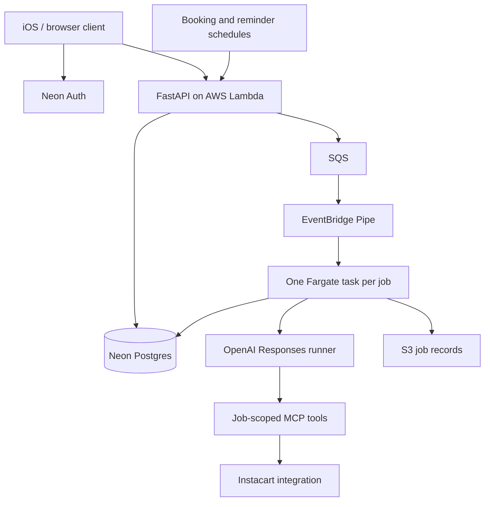

# Architecture

Bite Planner consists of an Ionic React/Capacitor client, a FastAPI API, a PostgreSQL database with Neon Auth, and one-shot agent workers. The [product requirements](../spec/requirements.md) define behavior; deployment details are in the [operations guide](operations/aws.md).

There are no continuously running API or worker servers. Scheduled booking/reminder work still runs independently of app activity.

## Client

`apps/mobile/src/` is the only client source. Vite builds it into `dist/`; Capacitor copies that output into the iOS project. The client has Orders, History, and Settings tabs, plus the create-order and recipe/cooking flows.

| Directory | Responsibility |
| --- | --- |
| `app/` | Providers, routes, session gate, native launch, recovery |
| `features/` | Screens, API calls, queries, and feature logic/tests |
| `ui/` | Shared controls, layouts, artwork, and feedback |
| `lib/` | API/auth adapters, query persistence, logging, haptics |
| `theme/` | Tokens and Ionic component styling |

TanStack Query caches server data and persists it through Capacitor Preferences. It refreshes on foreground entry and reconnect, and clears household/session data on sign-out. The release is the cache buster. Mutations made offline follow the relevant feature's queueing policy; recipe decisions and order-lock operations do not silently become deferred requests across a relaunch.

Neon Auth supplies signed JWTs. The API verifies them against its keys. Browser development proxies auth so cookies remain first-party; native iOS auth uses Capacitor's HTTP adapter with the configured trusted origin. API/auth URLs are observable in built clients and network traffic even though deployment configuration is not checked into Git.

## API and data

`backend/src/bite_planner/` owns database access, HTTP authorization, order state, and job dispatch. The app uses the API rather than direct database/Data API access.

An authenticated account belongs to at most one household. Orders, jobs, meals and product choices are scoped to that household; another household's resource is reported as missing. Invitations control membership and sign-up. Members can manage invitations and membership, while the last member cannot remove themselves.

Each household has one draft order. Its open flow holds an expiring `Order-Session` lock, renewed while active. The API checks that session before draft mutations, enforces one active suggestion batch, and refuses job-ID reuse across different requests or users. Time-zone-aware timestamps are stored in UTC; calendar delivery dates remain dates. The phone supplies its time zone for calendar policy.

Alembic manages schema changes. A worker refuses to start against an older schema; a database newer than the worker is allowed subject to the release/rollback policy.

Before rolling out migration `f27a1b9c40de`, drain old jobs. Older workers insert meals without `household_id` and are incompatible with the required column. The migration's `# contract:` marker blocks code-only rollback to those workers.

## Agent boundary

The backend starts one worker container for a job. It claims the database job, writes a bounded context, and starts an unprivileged agent runner with only that job's MCP functions. The runner uses the OpenAI Responses API and has no general shell, file tool, subagent, database credentials, or backend filesystem access. The MCP process does not receive the OpenAI key.

`backend/agent/src/bite_planner_agent/` contains the runner, tool servers, typed job files, and external-service adapters. The worker validates tool output before saving it to the database. Prompts in `backend/src/bite_planner/prompts/` are executable templates; update them together with their tool schemas.

Instacart search/cart access uses an operator-connected Codex/ChatGPT session. Browser checkout uses a protected Instacart website session from SSM. Neither connection is a public developer API key supplied by a contributor.

## Meal suggestions

The runner checks proposed names together with `check_meal_titles`, writes recipes with `add_meal`, then calls `done`. Preflight reserves nothing; adds and completion recheck under the job file lock. The worker validates the full batch against its original snapshot before storing any meals and marking the job succeeded in one transaction. A failed new batch leaves previous suggestions intact.

Novelty uses canonical meal names and original suggestion times. At job start the worker snapshots the household's current draft titles, earlier suggestions in the inclusive rolling UTC calendar month (clamping at month end), and current UP/FAVORITE titles of any age. Current-draft collisions always veto a candidate, including liked dishes. Across drafts, historical titles matching a current positive are exempt; other recent titles remain restricted, including unrated, DOWN and NOT_FOR_US suggestions. Durable `meal.household_id` ownership retains history after draft discard. Ratings or recipe edits during a run inform the next snapshot. Full household ratings inform the prompt; history lists stay outside it, and refusal messages identify the collided title.

One offline encoder supplies all comparisons: normalized-name equality or cosine >= 0.80 from the pinned Qdrant all-MiniLM-L6-v2 ONNX export. This conservative cutoff allows uncertain matches and misses some repeats; it is not comprehensive dish identity. Preflight, locked add, done and final worker validation share this rule. The full batch must finish within the existing 60-turn/15-minute bounds.

The worker and isolated tools install the agent's `meal-similarity` extra. Pinned assets are checksum-verified during setup/build and readable by uid 65532 at `/opt/bite-planner-models/minilm`; the API installs neither inference dependencies nor assets. Missing or corrupt assets fail explicitly. Inference never downloads models or uses a fallback.

## Approval and booking

Picking meals and preparing a cart do not authorize a purchase. The app obtains a delivery quote for a specific slot and shows its current review. Approving that review locks the order's accepted inputs. Booking is dispatched immediately when due or by the scheduled booking path; approval and grocery-service confirmation are distinct states.

The booking tool validates the approved quote against checkout, checks for an existing confirmation, and controls the one-shot purchase action. A changed cart or unapproved delivery window prevents a purchase. Prices may change between approval and booking; the confirmation shows the charged total. Uncertain purchase results are inspected and reported; retries do not blindly submit another purchase. The operator's booking mode can disable purchases or run without placing them.

Recipe edits follow a separate proposal/accept/reject flow. Accepting an edit can invalidate shopping work only according to its pinned inputs. The [shopping freshness matrix](../spec/requirements.md#shopping-freshness) is the canonical dependency contract.

## Notifications and records

APNs sends ready/booking notifications; local notifications support cooking timers. EventBridge Scheduler manages member reminder schedules. Dead-letter queues and worker-stop events reach the failure handler, which resolves failed/stalled jobs.

Services log structured JSON. On-device logs wait in a bounded outbox and upload for authenticated household members. Job prompts, tool transcripts and outputs are retained as protected S3 job records; the Instacart session is excluded. CloudWatch/S3 retention and diagnostic commands are in the operations guide. These application records are private operator data, separate from public GitHub CI logs.
